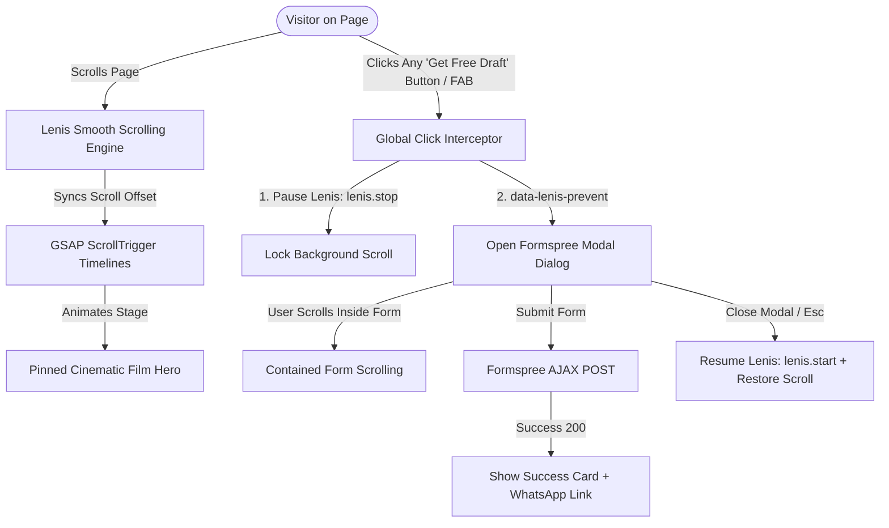

# Storebox Clone — Done-For-You Website, SEO & AEO Platform

[](https://storebox-clone.vercel.app/)
[](https://vitejs.dev/)
[](https://developer.mozilla.org/)
[](https://greensock.com/gsap/)
[](https://lenis.darkroom.engineering/)
[](https://formspree.io/)

A high-fidelity, cinema-grade recreation of the **Storebox** digital marketing and website platform. Built with modern vanilla web standards, featuring pinned viewport camera storytelling with **GSAP ScrollTrigger**, buttery-smooth inertial scrolling with **Lenis**, a minimalist floating action button (FAB) with a scroll-isolated **Formspree** draft request modal, dynamic multi-currency micro-CMS localization, and a complete multi-page architecture.

---

## Live Demo

Experience the live application deployed on Vercel:
**[https://storebox-clone.vercel.app/](https://storebox-clone.vercel.app/)**

---

## Key Features

### 1. Cinematic Pinned Hero & Scroll Choreography
- **GSAP 3.12 & ScrollTrigger:** The hero section pins to the viewport, guiding visitors through a sequential camera-pan narrative (*"You run the business"* → *"We build your site"* → *"Write your copy"* → *"Rank on Google & ChatGPT"* → *"From ₹799/mo"*).
- **Interactive Reading Rhythm:** Headline words dynamically illuminate as the user scrolls down the page.
- **Scroll Progress Indicator:** Ultra-thin top progress bar (`#pageProgressFill`) providing subtle real-time feedback on user reading progress.

### 2. Inertial Smooth Scrolling (Lenis v1.1.14)
- **Fluid Kinetic Physics:** Integrated Lenis smooth scroll engine synchronizing with the browser's `requestAnimationFrame` loop.
- **Sleek Custom Scrollbar:** Custom ultra-thin coral scrollbar (`rgba(255, 107, 44, 0.45)`) that seamlessly shifts to vibrant orange upon interaction.
- **Zero Scroll Jitter:** Perfectly coordinates with GSAP ScrollTrigger updates to prevent layout thrashing and stutter.

### 3. Floating Action Button (FAB) & Dedicated Form Modal
- **Obsidian Glass FAB:** Minimalist floating action button anchored at the bottom-right (`#draftFabBtn`) with glowing coral live-pulse indicator and backdrop blur.
- **Scroll-Lock Isolation (`data-lenis-prevent`):** Custom `<dialog>` modal that completely arrests background Lenis smooth scrolling while active, guaranteeing smooth, contained scrolling inside the form box.
- **AJAX Formspree Submission:** Zero-redirect asynchronous form submission with instant success confirmation, WhatsApp follow-up link, and auto-dismissal.
- **Modern Dialog Features:** Native light-dismiss fallback, `Esc` key dismissal, and backdrop blur filter (`rgba(10, 8, 6, 0.78)`).

### 4. Global Call-to-Action Delegation
- **Unified Event Pipeline:** Every *"Get my free draft"* button across the hero section, pricing tiers, preview cards, footer, and mobile drawer automatically opens the Formspree modal.
- **Deep Linking Support:** Navigating with or appending `#free-draft` to the URL automatically triggers the modal on load.

### 5. Multi-Page Architecture
- **Home (`index.html`):** Core landing page with client proof marquee, interactive comparison cards, FAQ accordions, and 24-hour draft preview box.
- **Transparent Pricing (`pricing.html`):** Full plan breakdowns, feature comparison matrices, and transparent pricing cards.
- **E-commerce Solutions (`ecommerce.html`):** Highlighting done-for-you online store creation, payments, inventory, and checkout setups.
- **AEO & GEO Search (`aeo-geo-seo.html`):** Deep dive into next-generation Answer Engine Optimization (ChatGPT, Perplexity, Gemini) and traditional Google SEO.

### 6. Dynamic Micro-CMS & Localization
- **Client-Side Data Hydration (`/data/in.js`):** Lightweight localization layer dynamically updating currency symbols, regional pricing, strike-through agency benchmarks, and copy strings across all templates without server-side rendering overhead.

---

## User Flow & Modal Architecture



---

## Tech Stack

| Layer | Technologies |
|---|---|
| **Build Tool & Bundler** | [Vite 5.4](https://vitejs.dev/) (Multi-Page Rollup Architecture) |
| **Animation & Motion** | [GSAP 3.12](https://greensock.com/gsap/), [ScrollTrigger](https://greensock.com/scrolltrigger/), [Lenis 1.1.14](https://lenis.darkroom.engineering/) |
| **Styling & Design System** | Vanilla Modern CSS, HSL Color Tokens, Obsidian Glassmorphism, Responsive Bento Grids |
| **Form Processing** | [Formspree](https://formspree.io/) REST API (Async Fetch/AJAX), HTML5 `<dialog>` API |
| **Typography** | [Fraunces](https://fonts.google.com/specimen/Fraunces) (Display Serif), [Outfit](https://fonts.google.com/specimen/Outfit) / [Inter](https://fonts.google.com/specimen/Inter) (Body & Sans) |
| **Localization & Data** | Vanilla JS Micro-CMS (`/data/in.js` dynamic variable hydration) |
| **Deployment** | Vercel / GitHub Pages / Static Web Server |

---

## Project Structure

```
Storebox_clone/
├── index.html              # Main Landing Page (Hero Film, Proof, FAQ, Modal)
├── pricing.html            # Transparent Pricing Plans & Comparison Table
├── ecommerce.html          # E-commerce Store Engine Showcase
├── aeo-geo-seo.html        # AI Search & AEO Optimization Guide
├── vite.config.js          # Multi-page build configuration
├── package.json            # Project scripts and dev dependencies
├── .gitignore              # Ignored files (node_modules, dist, .agents)
└── public/
    ├── data/
    │   └── in.js           # Dynamic regional pricing and copy data
    └── assets/
        ├── js/
        │   ├── gsap.min.js          # GSAP core animation library
        │   ├── ScrollTrigger.min.js # GSAP ScrollTrigger plugin
        │   ├── lenis.min.js         # Lenis smooth scroll engine
        │   └── main.js              # Interactions, modal controller & Formspree AJAX
        └── media/
            ├── favicon.svg          # Storebox brand favicon
            └── *.png / *.jpg        # Client portfolio mockups and media
```

---

## Getting Started

### Prerequisites
- **Node.js**: 18.x or higher
- **npm** or **pnpm** / **yarn**

### 1. Clone the Repository
```bash
git clone https://github.com/mizan989/Storebox_clone.git
cd Storebox_clone
```

### 2. Install Dependencies
```bash
npm install
```

### 3. Run Development Server
```bash
npm run dev
```
The application will be available at:
**`http://localhost:3000`**

### 4. Build for Production
To generate the optimized production bundle:
```bash
npm run build
```
Compiled static assets will be output to the `dist/` directory.

To preview the production build locally:
```bash
npm run preview
```

---

## Formspree Configuration

The free draft request form is powered by [Formspree](https://formspree.io/). To route submissions to your own email:

1. Create a free form at [formspree.io](https://formspree.io/).
2. Locate the `<form id="storeboxDraftModalForm">` element in [index.html](index.html) and [public/index.html](public/index.html).
3. Replace the `action` attribute URL with your Formspree endpoint:
   ```html
   <form id="storeboxDraftModalForm" action="https://formspree.io/f/YOUR_FORM_ID" method="POST">
   ```
4. Form submissions will automatically deliver leads directly to your inbox with instant user confirmation and direct WhatsApp routing.

---

## Author

**Md Mizan**
- GitHub: [@mizan989](https://github.com/mizan989)
- Portfolio: [mizan989.github.io](https://github.com/mizan989)

---

## License

This project is created for educational and portfolio demonstration purposes. All rights and brand assets belong to their respective owners.
