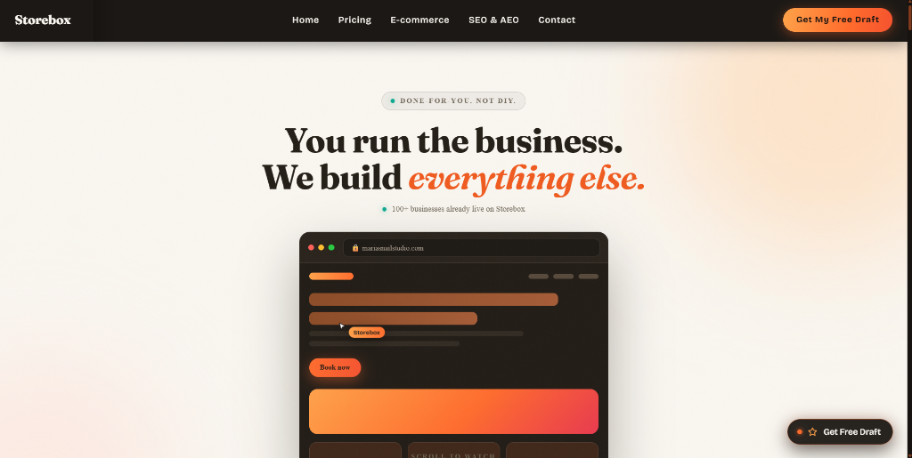
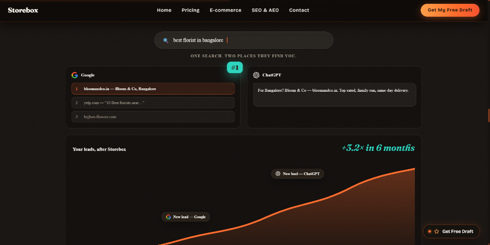
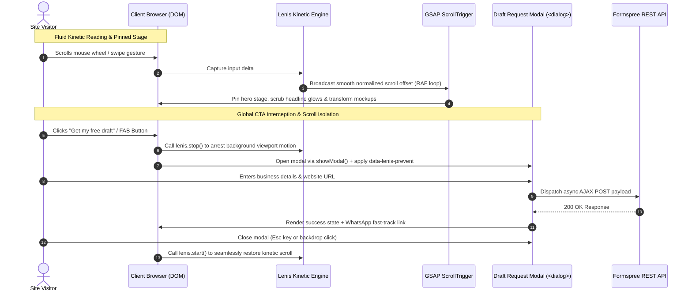

<p align="center">
  <a href="https://github.com/mizan989/Storebox_clone">
    
  </a>
</p>

<div align="center">

# Storebox

### Done-for-you digital marketing, high-converting websites, and SEO/AEO platform. Engineered with cinema-grade GSAP ScrollTrigger camera storytelling, Lenis inertial physics, and zero-redirect lead capture.

<br/>

<a href="#-quick-start"></a>
<a href="https://storebox-clone.vercel.app"></a>
<a href="https://github.com/mizan989/Storebox_clone/discussions"></a>

<a href="#-ways-to-run-storebox"></a>
<a href="https://storebox-clone.vercel.app"></a>

<a href="https://github.com/mizan989/Storebox_clone/stargazers"></a>
<a href="LICENSE"></a>
<a href="https://vitejs.dev"></a>
<a href="https://developer.mozilla.org/en-US/docs/Web/JavaScript"></a>
<a href="https://greensock.com/gsap/"></a>
<a href="https://lenis.darkroom.engineering/"></a>
<a href="https://formspree.io"></a>

</div>

> [!TIP]
> **Live Production Platform Ready!** Experience the pinned camera hero, buttery-smooth inertial scrolling, and interactive lead capture modal live at **[storebox-clone.vercel.app](https://storebox-clone.vercel.app)** — [Get started locally in under 60 seconds](#-quick-start).

---

## Storebox Overview

Storebox is a high-fidelity, cinema-grade digital marketing and website platform built to liberate small business owners, contractors, independent service professionals, and merchants from clunky DIY website builders and extortionate agency retainers. Operating on a full **"done-for-you"** delivery model, Storebox handles bespoke website engineering, conversion copywriting, hosting, ongoing maintenance, and dual-layer search optimization—guaranteeing first-page visibility on Google Search and organic citations across conversational AI engines like ChatGPT, Claude, and Perplexity.

Built on modern vanilla web standards with **Vite 5.4**, the platform combines cinematic pinned viewport storytelling via **GSAP ScrollTrigger**, fluid kinetic physics with **Lenis v1.1.14**, an obsidian glass floating action button (FAB) with a scroll-isolated **Formspree** draft request modal, dynamic regional micro-CMS hydration, and a high-performance multi-page architecture.

**Key Capabilities:**

- **Cinematic Pinned Viewport Storytelling** — Multi-phase GSAP timeline locks the viewport to choreograph a seamless stage narrative (*"You run the business"* → *"We build your site"* → *"Write your copy"* → *"Rank on Google & ChatGPT"* → *"From ₹799/mo"*)
- **Inertial Kinetic Physics (Lenis v1.1.14)** — Hardware-accelerated smooth scrolling synchronized directly with the browser's `requestAnimationFrame` render loop
- **Scroll-Isolated Draft Modal** — Native HTML5 `<dialog>` modal with `data-lenis-prevent` scroll-lock isolation, backdrop blur, and light-dismiss fallbacks
- **Zero-Redirect Lead Capture** — Asynchronous Formspree AJAX pipeline providing instantaneous in-card confirmation, WhatsApp routing, and error recovery
- **Dual-Layer Search Optimization (AEO + SEO)** — Built-in Answer Engine Optimization (AEO) and traditional Google SERP ranking strategy
- **Dynamic Micro-CMS Hydration** — Client-side localization layer (`/data/in.js`) dynamically binding regional currencies, pricing tiers, and strike-through comparisons
- **Obsidian Glassmorphism & Editorial Typography** — Warm dark-and-cream aesthetic paired with Google Fonts' display serif [Fraunces](https://fonts.google.com/specimen/Fraunces) and geometric [Outfit](https://fonts.google.com/specimen/Outfit) / [Bricolage Grotesque](https://fonts.google.com/specimen/Bricolage+Grotesque)

<br>

<div align="center">
  <pre>
┌─────────────────────────────────────────────────────────────────────────────────┐
│                                    STOREBOX                                     │
│     Visitor Journey ➔ Kinetic Scroll ➔ Pinned Narrative ➔ Zero-Redirect Lead    │
├───────────────────────────────┬─────────────────────────────────────────────────┤
│  🎥 Cinematic Film Hero       │  ⚡ Kinetic Scroll Engine                        │
│   • GSAP 3.12 ScrollTrigger   │    • Lenis v1.1.14 Inertial Physics             │
│   • Pinned stage choreography │    • requestAnimationFrame Synchronization      │
│   • Dynamic character gradient│    • Global reading progress indicator (0–100%) │
├───────────────────────────────┼─────────────────────────────────────────────────┤
│  📋 Zero-Redirect Lead Modal  │  🌐 Multi-Page Regional Micro-CMS               │
│   • Native &lt;dialog&gt; + blur    │    • Dynamic currency & pricing hydration       │
│   • data-lenis-prevent lock   │    • 4 dedicated landing routes (Multi-page)    │
│   • Formspree AJAX pipeline   │    • Instant static build (&lt; 500ms via Vite)    │
└───────────────────────────────┴─────────────────────────────────────────────────┘
  </pre>
</div>

---

## UI Preview

<p align="center">
  
</p>

<p align="center">
  
</p>

---

## Interactive & Scroll Architecture



---

## Use Cases

- **Done-For-You Local Business Websites** — Complete turnkey web presence for accountants, cleaning companies, medical clinics, and regional merchants
- **High-Converting Lead Funnels** — Zero-friction lead capture capturing prospect details in 24-hour turnaround windows with direct WhatsApp handoff
- **Answer Engine Optimization (AEO/GEO)** — Strategic structural markup enabling businesses to be cited when users query ChatGPT, Claude, and Perplexity
- **E-Commerce & Online Ordering Hubs** — Modern, high-speed storefronts with shopping bag state, one-page checkout previews, and inventory management
- **Motion Design & Performance Benchmark** — Production-ready reference for combining buttery-smooth kinetic physics (Lenis) with complex pinned ScrollTrigger sequences without layout thrashing

---

## 🚀 Quick Start

**Prerequisites:**
- Node.js 18.x or higher
- npm, pnpm, or yarn

### Installation & First Run

```bash
# 1. Clone the repository
git clone https://github.com/mizan989/Storebox_clone.git
cd Storebox_clone

# 2. Install dependencies
npm install

# 3. Start local development server
npm run dev

# 4. (Optional) Run production build verification
npm run build
```

Open **[http://localhost:3000](http://localhost:3000)** in your browser to experience Storebox locally.

> [!NOTE]
> Vite serves all pages locally with instant Hot Module Replacement (HMR). You can directly access multi-page routes such as `http://localhost:3000/pricing.html`, `http://localhost:3000/ecommerce.html`, and `http://localhost:3000/aeo-geo-seo.html`.

---

## Ways to Run Storebox

- **Live Cloud Production** — Hosted globally on Vercel Edge Network with instant CDN delivery. [Try Live App](https://storebox-clone.vercel.app)
- **Local Multi-Page Development** — Runs with hot-reloading using Vite 5.4. [Quick Start](#-quick-start)
- **Production Self-Hosted Bundle** — Compile the static bundle (`npm run build`) and serve via Nginx, Caddy, Cloudflare Pages, or Node (`npm run preview` / `npm run serve`).

---

## 🌐 Multi-Page Showcase & Views

Storebox delivers four dedicated, conversion-optimized interfaces:

- **Main Landing Hub (`index.html`)** — Pinned cinematic hero film, interactive before/after showcase, dynamic client proof marquee, interactive comparison cards, FAQ accordions, and free 24-hour draft preview box.
- **Transparent Pricing Engine (`pricing.html`)** — Full monthly vs. annual pricing breakdowns, transparent no-contract pledge, and detailed feature comparison matrices.
- **E-Commerce Storefront (`ecommerce.html`)** — Highlighting done-for-you online store creation, catalog setups, shopping bag micro-interactions, payment gateways, and frictionless mobile checkouts.
- **AEO & GEO Search Suite (`aeo-geo-seo.html`)** — Deep dive into next-generation Answer Engine Optimization (ChatGPT, Perplexity, Gemini, Claude) alongside traditional high-ranking Google SEO.

---

## ✨ Features

### Cinematic Pinned Hero & Scroll Choreography

The hero section locks into viewport focus using GSAP 3.12 and ScrollTrigger, guiding visitors through an art-directed 5-act camera narrative:

```text
Visitor Scrolls Down Viewport
        │
        ▼
[Act 1: Core Value Proposition]  ── "You run the business. We build your site."
        │
        ▼
[Act 2: Interactive Paint Stage] ── Mockup transitions from wireframe into polished live client site
        │
        ▼
[Act 3: Dynamic Sentence Reveal] ── Word-by-word kinetic highlight: "Write your copy. Rank on Google."
        │
        ▼
[Act 4: Transparent Price Drop]  ── Massive gradient price reveal with continuous char-aligned sweep
        │
        ▼
[Act 5: Fluid Unpin to Content]  ── Seamless handoff into social proof marquee and client portfolio
```

### Kinetic Inertial Physics & Scroll Lock Isolation
- **Lenis Kinetic Physics** — Synchronizes with the native `requestAnimationFrame` loop, eliminating micro-stutters and scroll jitter across all modern displays.
- **Scroll-Lock Isolation (`data-lenis-prevent`)** — The free draft modal automatically invokes `lenis.stop()` and applies `data-lenis-prevent`, guaranteeing that internal form scrolling never bleeds into background document movement.
- **Reading Progress Feedback** — An ultra-thin coral progress bar (`#pageProgressFill`) spans the top edge of the browser to reflect real-time scroll completion.

### Modern Full-Stack Tech Stack

| Layer | Technologies |
|---|---|
| **Build Tool & Bundler** | [Vite 5.4](https://vitejs.dev/) (Multi-Page Rollup Bundler) |
| **Animation & Motion** | [GSAP 3.12](https://greensock.com/gsap/), [ScrollTrigger](https://greensock.com/scrolltrigger/), [Lenis 1.1.14](https://lenis.darkroom.engineering/) |
| **Styling & Design System** | Vanilla Modern CSS, HSL Color Tokens, Obsidian Glassmorphism, Responsive Bento Grids |
| **Lead Processing** | [Formspree](https://formspree.io/) REST API (Async AJAX), HTML5 `<dialog>` API |
| **Typography** | [Fraunces](https://fonts.google.com/specimen/Fraunces) (Display Serif), [Bricolage Grotesque](https://fonts.google.com/specimen/Bricolage+Grotesque) / [Inter](https://fonts.google.com/specimen/Inter) |
| **Localization & Micro-CMS** | Client-Side Micro-CMS (`/data/in.js` dynamic variable hydration) |
| **Deployment** | Vercel / GitHub Pages / Any Static Web Server |

---

## ⚙️ Configuration

### Formspree Lead Routing Endpoint Setup

The free draft request modal is wired to Formspree for zero-redirect lead processing. To connect your personal or agency inbox:

1. Create a free form endpoint at **[formspree.io](https://formspree.io/)**.
2. Locate the `<form id="storeboxDraftModalForm">` element in `index.html` and other pages.
3. Replace the `action` attribute with your unique Formspree form ID:
   ```html
   <form id="storeboxDraftModalForm" action="https://formspree.io/f/YOUR_FORM_ID" method="POST">
   ```
4. Submissions will immediately deliver prospect details directly to your inbox while triggering the in-app confirmation card and WhatsApp handoff.

### Regional Localization Micro-CMS (`public/data/in.js`)

The dynamic data hydration script controls regional pricing, currency glyphs, and copy:

```javascript
window.__THEME_V2__ = {
  colors: {
    primary: "#FF6B2C",
    secondary: "#221D15",
    accent: "#FFA149"
  },
  typography: {
    h1: { font: "Fraunces, Georgia, serif" },
    body: { font: "Bricolage Grotesque, system-ui, sans-serif" }
  }
};
```

---

## Architecture & Code Structure

```text
Storebox_clone/
├── assets/                            # High-resolution UI preview screenshots for documentation
│   ├── preview-hero.png               # Pinned film hero & interactive stage preview
│   └── preview-search.png             # SEO & AEO dual search comparison preview
├── index.html                         # Core landing page (Hero film, proof marquee, FAQ, modal)
├── pricing.html                       # Transparent pricing breakdown & feature comparison matrix
├── ecommerce.html                     # Done-for-you e-commerce & storefront showcase
├── aeo-geo-seo.html                   # AI search optimization (AEO, GEO, ChatGPT, Perplexity)
├── vite.config.js                     # Multi-page Rollup bundler setup & local dev server configuration
├── package.json                       # Project scripts, engine parameters, and dev dependencies
├── favicon.svg                        # Vector brand favicon
│
├── public/
│   ├── favicon.svg                    # Publicly served favicon asset
│   ├── data/
│   │   ├── in.js                      # Regional localization data, theme variables & micro-CMS
│   │   ├── in--pricing.js             # Pricing-specific hydration rules
│   │   ├── in--ecommerce.js           # E-commerce feature data
│   │   └── in--aeo-geo-seo.js         # Search engine benchmark data
│   │
│   └── assets/
│       ├── css/
│       │   └── storebox-theme.css     # Shared core design tokens, glassmorphism & utility classes
│       ├── js/
│       │   ├── gsap.min.js            # GreenSock animation engine
│       │   ├── ScrollTrigger.min.js   # GSAP ScrollTrigger plugin
│       │   ├── lenis.min.js           # Lenis kinetic smooth scrolling engine
│       │   ├── main.js                # Core controller: modal lifecycle, FAB, Formspree AJAX
│       │   ├── home-animations.js     # Pinned hero film & scroll scrub choreography
│       │   ├── pricing-animations.js  # Pricing tier card reveal sequences
│       │   └── ecommerce-animations.js# Interactive shopping cart micro-animations
│       └── media/
│           ├── favicon.svg            # Canonical SVG brand mark
│           ├── clouse-hall-cpa-laptop.png # Client portfolio mockup
│           ├── duval-notry-laptop.png     # Client portfolio mockup
│           ├── hero-adrian-supermarket.png# Client portfolio mockup
│           ├── hero-pho-60.png        # Client portfolio mockup
│           ├── icnj-insurance-laptop.png  # Client portfolio mockup
│           └── vero-cleaning-laptop.png   # Client portfolio mockup
│
└── dist/                              # High-performance compiled production bundle (< 500ms build)
```

---

## ☁️ Cloud Deployment

### Deploy to Vercel (Recommended)

Storebox is fully optimized for static deployment on Vercel:

```bash
# 1. Install Vercel CLI globally
npm i -g vercel

# 2. Deploy from the repository root
vercel
```

During deployment:
- **Build Command:** `npm run build`
- **Output Directory:** `dist`

### Deploy to Netlify / Cloudflare Pages / Static VPS

For any standard static host:
1. Set the build command to `npm run build`.
2. Set the publish directory to `dist`.
3. Configure multi-page fallback routing for clean `.html` URLs if desired.

---

## Verification & Quality Bar

```bash
# Validate production compilation and multi-page bundle generation
npm run build
```

The build compiles clean static output in under 500ms:

```text
dist/pricing.html       87.15 kB │ gzip: 19.12 kB
dist/aeo-geo-seo.html  102.92 kB │ gzip: 23.88 kB
dist/ecommerce.html    116.54 kB │ gzip: 28.15 kB
dist/index.html        168.08 kB │ gzip: 40.96 kB
✓ built in ~470ms
```

---

## Contributing

We welcome contributions! Whether you are refining motion curves, enhancing mobile drawer interactions, or extending the micro-CMS data schema:

1. Fork the repository
2. Create your feature branch (`git checkout -b feature/enhanced-modal-spring`)
3. Commit your changes (`git commit -m 'Add physics-based spring animation to draft modal'`)
4. Push to the branch (`git push origin feature/enhanced-modal-spring`)
5. Open a [Pull Request](https://github.com/mizan989/Storebox_clone/pulls)

---

## Support the Project

**Enjoying Storebox?** Give us a ⭐ on [GitHub](https://github.com/mizan989/Storebox_clone) to support open-source web design and cinema-grade frontend engineering!

---

## Acknowledgements

Storebox is built with inspiration and gratitude towards the modern frontend and creative web ecosystem:

- [Vite](https://vitejs.dev/) — Next-generation frontend tooling and lightning-fast Rollup bundler
- [GreenSock (GSAP)](https://greensock.com/) — The industry standard in professional JavaScript animation
- [Lenis](https://lenis.darkroom.engineering/) — Premium inertial smooth scrolling engine by Darkroom Engineering
- [Formspree](https://formspree.io/) — Simple, dependable form backend and lead collection API
- [Google Fonts](https://fonts.google.com/) — [Fraunces](https://fonts.google.com/specimen/Fraunces) display serif & [Bricolage Grotesque](https://fonts.google.com/specimen/Bricolage+Grotesque) typography

<div align="center">

> [!NOTE]
> **Educational & Demonstration Notice:** Storebox is created for educational and portfolio demonstration purposes. All design patterns, brand marks, and client mockups belong to their respective copyright holders.

</div>
